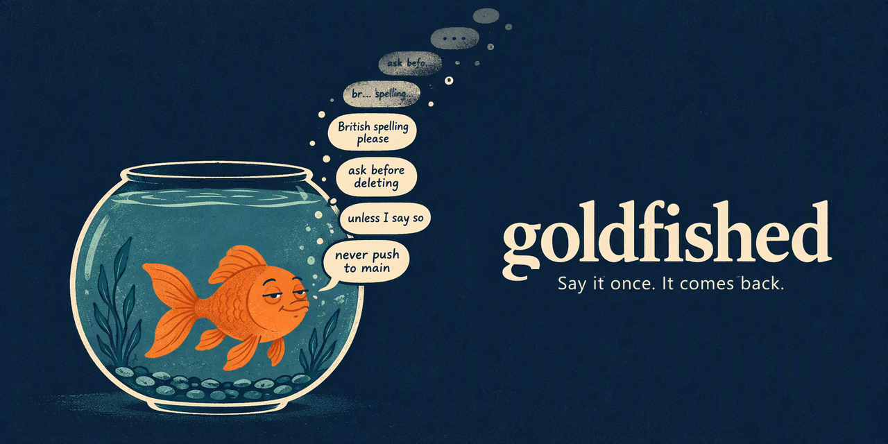

# goldfished

How long is your coding agent's memory? Measured from your own sessions.

```sh
npx goldfished@latest retro
```

```text
Invented example, not real data.
goldfished retro   last 30 days   read-only, nothing leaves this machine
read 427 files (734.5 MB) in 8s. not graded: 17 automated sessions, 29 subagent
  files

Memory span: 1 compaction
18 in 100 of your messages were still in front of the agent after 4 compactions
(95% range 11 to 27), 300 messages, 13 sessions, Agent A, 3 Sep 2026 to 28 Sep
  2026.
Short memory. More than half your words are gone by the second compaction.
4 sessions had the card re-sent after compaction; they are counted apart.
This counts your words in what the agent can still see (the summary and the
  recent messages it keeps), not whether it still acted on them.

agent         sessions   compacted   messages   memory span    kept after 4
Agent A       287        64          2,837      1              18 in 100
Agent B       76         23          945        at least 4     56 in 100
Agents compact differently and you use them differently. This compares your
sessions, not the tools.

Agent A, by times compacted
times compacted   your messages   kept   partly there   not found
1                 1,360           95%    3%             3%
2                 720             42%    15%            43%
3                 480             24%    15%            61%
4                 300             18%    16%            66%
(each row counts the messages that went through exactly that many compactions)
Same messages throughout: kept after 1 / 2 / 3 = 93 / 50 / 32 in 100.

not counted: 345 short replies under 20 characters, 73 pastes over 1,500
  characters
Keep your goal and rules in front of your agent: npx goldfished init
```

Offline. Reads your own local session files. Nothing leaves your machine. goldfished itself sends nothing; the card is handed to your agent, which sends it to its model like any other prompt.

Claude Code's `cleanupPeriodDays` setting defaults to 30 days, so older session files may no longer be there.

## What it measures

Coding agents compact long conversations by replacing them with a summary they write themselves. Things you said can fall out. goldfished reads the local session files and measures how much of your wording remains in what the agent can still see: the summary and any recent messages it keeps.

- **Memory span** is how many compactions your messages survive with at least half still kept at every measurable age up to that point. An age is the number of compactions a message has been through. "At least" means the measured rows have not yet fallen below half.
- **Kept per 100** counts messages whose wording is still there, rather than individual words. The other labels are **partly there** and **not found**. It does not measure whether the agent still follows what you said.
- **The 95% range** shows uncertainty in the kept rate, allowing for messages from the same session being related. It is a range for the estimate, not a promise about your next message.
- **Too few** stays until an age has at least 10 sessions and 50 messages. Below that, counts can be shown but rates and memory span are withheld.

The curve stops at age 6. Each row counts messages that went through exactly that many compactions. Sessions where goldfished re-sent the card are counted apart from the ordinary curve, span and headline. Agents are also counted apart: this compares your sessions, not the tools.

Kept is decided by G3, a local word-run match with threshold 0.9 and no model ([src/grade.mjs](src/grade.mjs)). In the sealed run, the grader matched the blind three-way label (kept, reworded or gone) on 79 of 100 invented pairs, and kept versus not kept on 100 of 100. The sealed run gated on kept versus not kept; distinguishing reworded from gone remains a stated limit. The printed labels are kept / partly there / not found. A summary can retain your wording while the agent ignores it. See [TESTED.md](TESTED.md) and the [raw sealed run](bench/runs/2026-10-19-bars.txt). Reproduce it from the repository root:

```sh
node scripts/bars.mjs test/labels/test.jsonl
```

Try the invented example without reading any session files:

```sh
npx goldfished@latest retro --demo
```

## What we measured

On our invented heavy story, Claude Code kept every typed decision through 30 forced compactions. Codex kept none older than 8 compactions. These are one story each, with forced or lowered compaction, and real sessions may differ. See [TESTED.md](TESTED.md) for the runs and their limits.

## Keep your goal and rules

The card lives at `.goldfished/card.md` in your project. It holds your goal, standing rules and ruled-out options in your own words.

```sh
npx goldfished@latest init
goldfished goal "Make the local search usable without a server."
goldfished rule "Keep the index on this machine."
goldfished out "Hosted search" --quote "Do not send the index to a hosted service."
```

Use `npx goldfished@latest <command>` for each command if goldfished is not installed. Card changes come from you, at a terminal or through the two chat prefixes; agents can only propose. You accept or reject their proposals. A changed file is not trusted until its fingerprint matches the one recorded on this machine.

Where the prompt hooks are proved, `rule: ` at the start of a message saves the rule and still sends your message to the agent unchanged. `gf: ` is answered on screen and never reaches the agent. Ordinary prompts pass through. `probe` lets you check whether your own agent keeps the card.

## Agents

These claims are backed by the fixture tests and live proofs in [TESTED.md](TESTED.md). A fixture proves how goldfished handles an invented file; it does not prove what a live agent writes or displays.

| Agent | retro | What `init` gives it | Re-send after compaction | In-chat prefixes |
| --- | --- | --- | --- | --- |
| claude-code | curve | CLAUDE.md pointer if untracked or `--shared`; the plugin is the main route | plugin hook | `rule:`, `gf:` |
| codex | curve, invented-file tests only; live transcript proof failed | AGENTS.md pointer | hook, after you trust it in Codex | `rule:`, `gf:` |

The live proofs record agent versions in TESTED.md. Interactive display has not been observed in those headless proofs. Claude Code's plugin uninstall can leave an orphaned cached copy; the failed residue proof records that limit. Codex's tested live transcript did not expose typed messages in the form the adapter reads, so its fixture curve is not a claim of working live retro support.

## Commands

Run `goldfished <command> --help` for flags. With no command, goldfished runs `retro`.

- `retro [--agent <id>|all] [--dir <path>] [--days <n>] [--names] [--show] [--audit] [--json] [--save] [--demo]`: measure your local sessions; `--dir` needs a single agent.
- `shapes [--agent <id>] [--dir <path>]`: show record types, counts and format checks without message text.
- `init [--agents <ids>] [--shared] [--commit] [--yes] [--dry-run]`: show and install the project's card wiring.
- `uninit [--yes]`: remove the installed wiring.
- `goal "<text>"`: set the goal.
- `rule "<text>"`: add a standing rule.
- `out "<label>" --quote "<your words>"`: record an option you ruled out.
- `edit <id> "<text>"`: change a card entry.
- `drop <id>`: remove an entry from the active card.
- `restore <id>`: bring a dropped entry back.
- `list`: list card entries.
- `card [--agent <id>]`: print the card as the agent receives it.
- `propose --quote "<words>" --note "<note>"`: queue an agent's suggestion for your decision.
- `accept <pN> ["<label>"]`: accept a proposal.
- `reject <pN>`: reject a proposal.
- `trust`: trust the current card on this machine.
- `probe <agent> [--saw yes|no]`: test card retention and record what you saw.
- `hooks <agent>`: print hook setup without writing it.
- `hook <agent> <event>`: the internal entry point called by agent hooks.
- `doctor`: show local setup, card trust, pointers and probe results.
- `purge [--yes]`: delete goldfished's local home; cards then need trusting again.

## Privacy

goldfished uses no network code, has zero runtime dependencies and runs no install scripts. `retro` writes nothing unless you request `--save`, which saves counts only. Default output has no message text, paths below a root or project names. `--json` always contains counts only. `--show` and `--audit` display text; treat that output as private.

Writes are confined to the card and its siblings, the pointer blocks and owned files shown by `init`, the local Git exclude list and `~/.goldfished/`. `GOLDFISHED_HOME` moves that home. Real session files never belong in this repository, tests, fixtures or issue reports. See [SECURITY.md](SECURITY.md) for the file list and private reporting route.

## Requirements and speed

Node 20 or newer. Windows, macOS and Linux.

The benchmark read 6 GiB in 10.540 s for Claude Code and 24.568 s for Codex, on an Intel(R) Core(TM) Ultra 9 290HX Plus with 63.46 GiB RAM, Windows and Node v24.19.0. These are warm medians on synthetic files, not live transcripts. See the [whole run](bench/runs/2026-10-19-bench.txt).

The [raw run logs](bench/runs/) are committed. `node scripts/readme-numbers.mjs` is a presence check: every README number appears in a committed log, TESTED.md or the short list in the script. It also compares the example byte for byte with a fresh demo.

## Contributing

goldfished is tested on Claude Code and Codex. Other agents are welcome: if you use one, your reports and your code are how it gets supported. To report a bug, run `npx goldfished bug` and paste the output into an issue; it prints counts and fixed words only, never session text, a path or a project name. [CONTRIBUTING.md](CONTRIBUTING.md) covers format changes, probing an agent, adding one, and what the checks expect of a pull request.

[MIT licence](LICENSE).
